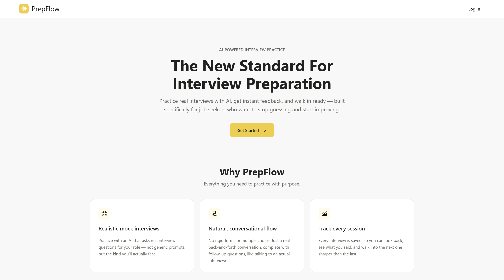

<a name="readme-top"></a>

<div align="center">


# AI Interview Simulator

[![License: MIT][license-shield]][license-url]
[![React][react-shield]][react-url]
[![Node.js][node-shield]][node-url]
[![Supabase][supabase-shield]][supabase-url]
[![Gemini][gemini-shield]][gemini-url]

<a href="https://carloswong1.github.io/AI-Interview-Simulator/"><strong>« Try the Live Demo »</strong></a>

</div>

---

## Overview

PrepFlow is a full-stack web application for practicing job interviews in a structured, low-pressure environment. Choose a topic, complete a text-based interview with three AI-generated questions, and receive personalized feedback on your answers.

PrepFlow is **not** a voice interview or a live, adaptive conversation. The questions are generated for the selected topic; they do not change based on your previous answers.

The app also saves completed interviews so you can review feedback and monitor your practice over time.

## Features

- **Six interview topics**: Frontend Development, Backend Development, System Design, Data Structures & Algorithms, Behavioral Interview, and Product Management.
- **AI-generated questions**: Three questions for each interview session, answered by typing.
- **Personalized feedback**: Overall score, strengths, areas for improvement, and feedback for each question.
- **Interview history**: Revisit completed interviews and their results.
- **Progress dashboard**: View interview statistics, recent sessions, and your daily practice streak.
- **User accounts**: Sign up, sign in, and access your own interview records using Supabase Authentication.
- **Protected API**: Backend authentication and request rate limiting for AI interview endpoints.

## Tech Stack

| Layer                     | Technologies                                                        |
| ------------------------- | ------------------------------------------------------------------- |
| **Frontend**              | React, Vite, JavaScript, Tailwind CSS, React Router, Lucide React   |
| **Backend**               | Node.js, Express                                                    |
| **Database & auth**       | Supabase (PostgreSQL, Auth)                                         |
| **AI**                    | Google Gemini API                                                   |
| **Testing**               | Node.js test runner, Supertest                                      |
| **Deployment & CI/CD**    | GitHub Pages (frontend), Render (backend), GitHub Actions           |

## How It Works

1. Create an account or sign in.
2. Choose a topic from the six available practice areas.
3. Start an interview and answer three AI-generated questions in text.
4. Receive feedback after submitting the final answer.
5. Review your results and track your interview history and daily practice streak on the dashboard.

## Application Architecture

```text
React + Vite frontend (GitHub Pages)
  ├── Supabase Auth (sign-in and sessions)
  ├── Supabase database (interviews, messages, feedback)
  └── Express API (Render)
        ├── Auth verification and rate limiting
        └── Google Gemini API (questions and evaluation)
```

The Gemini API key stays on the server; it should never be placed in a `VITE_` environment variable.

## Getting Started

### Prerequisites

- Node.js and npm (use a version supported by the installed Vite release)
- A [Supabase](https://supabase.com) project
- A [Google Gemini API key](https://aistudio.google.com/apikey)

### Local Setup

1. Clone the repository

   ```sh
   git clone https://github.com/CarlosWong1/AI-Interview-Simulator.git
   cd AI-Interview-Simulator
   ```

2. Install dependencies

   ```sh
   npm install
   npm install --prefix client
   npm install --prefix server
   ```

3. Create `client/.env`

   ```env
   VITE_SUPABASE_URL=your_supabase_project_url
   VITE_SUPABASE_ANON_KEY=your_supabase_anon_key
   VITE_API_URL=http://localhost:5000
   ```

4. Create `server/.env`

   ```env
   PORT=5000
   GEMINI_API_KEY=your_gemini_api_key
   SUPABASE_URL=your_supabase_project_url
   SUPABASE_ANON_KEY=your_supabase_anon_key
   SUPABASE_SERVICE_ROLE_KEY=your_supabase_service_role_key
   ```

   > **Important:** Never commit `.env` files or expose the Supabase service-role key or Gemini API key in frontend code.

5. Configure Supabase

   This repository requires a Supabase project with the application's `interviews` and `messages` tables, authentication configured, and appropriate row-level security policies. The environment variables alone do not create the database schema. You will need to configure the schema and policies separately to run your own instance.

6. Start the frontend and backend

   ```sh
   npm run dev
   ```

   The Vite frontend runs locally (normally at http://localhost:5173) and the Express API listens on http://localhost:5000.

### Run Checks

```sh
npm run lint --prefix client
npm run build --prefix client
npm test --prefix server
```

## Screenshots

### Landing Page



## Current Limitations

- Interviews are text-only; voice input and audio responses are not supported.
- Each session uses three generated questions, without adaptive follow-up questions.
- The daily streak is calculated from the creation dates of interviews that have completed feedback; an interview spanning midnight is attributed to its start date.
- The repository does not currently provide a one-command Supabase database/schema setup.

## Roadmap

- [x] Topic-based AI interview questions
- [x] AI-generated interview feedback and results
- [x] Interview history and dashboard statistics
- [x] Daily practice streak tracking
- [ ] Voice-based interviews
- [ ] Adaptive follow-up questions
- [ ] Progress visualizations across multiple interviews
- [ ] More specialized interview topics

## About This Project

PrepFlow is a personal full-stack portfolio project built to practice integrating a React frontend, an Express backend, authentication, a database, and an external AI API into a complete application. It also includes automated backend tests and a CI/CD workflow.

Suggestions and bug reports are welcome through [GitHub Issues](https://github.com/CarlosWong1/AI-Interview-Simulator/issues).

## License

Distributed under the MIT License. See [`LICENSE`](LICENSE) for more information.

## Contact

Carlos Wong — [GitHub](https://github.com/CarlosWong1)

Repository: [AI-Interview-Simulator](https://github.com/CarlosWong1/AI-Interview-Simulator)

Live site: [PrepFlow](https://carloswong1.github.io/AI-Interview-Simulator/)

## Acknowledgments

- [Google Gemini](https://ai.google.dev/)
- [Supabase](https://supabase.com/)
- [Lucide](https://lucide.dev/)

<p align="right"><a href="#readme-top">Back to top</a></p>

<!-- MARKDOWN LINKS & IMAGES -->
[license-shield]: https://img.shields.io/badge/License-MIT-yellow.svg
[license-url]: LICENSE
[react-shield]: https://img.shields.io/badge/React-20232A?style=for-the-badge&logo=react&logoColor=61DAFB
[react-url]: https://reactjs.org/
[node-shield]: https://img.shields.io/badge/Node.js-339933?style=for-the-badge&logo=nodedotjs&logoColor=white
[node-url]: https://nodejs.org/
[supabase-shield]: https://img.shields.io/badge/Supabase-3FCF8E?style=for-the-badge&logo=supabase&logoColor=white
[supabase-url]: https://supabase.com/
[gemini-shield]: https://img.shields.io/badge/Gemini-8E75B2?style=for-the-badge&logo=google_gemini&logoColor=white
[gemini-url]: https://ai.google.dev/
